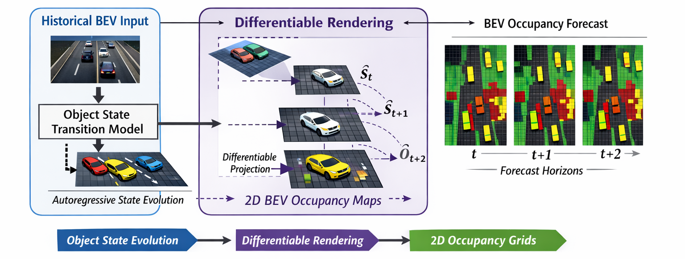
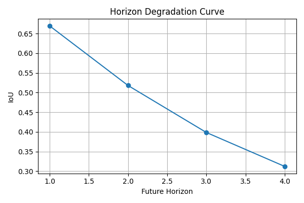
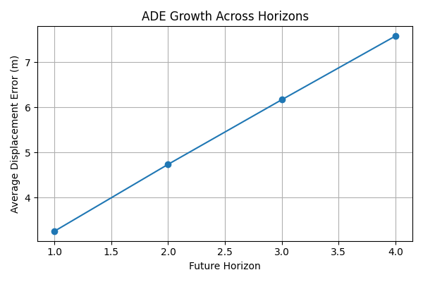
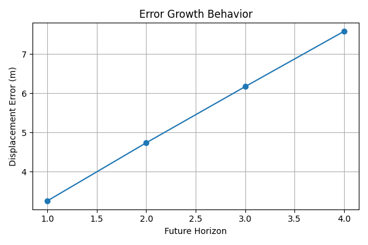
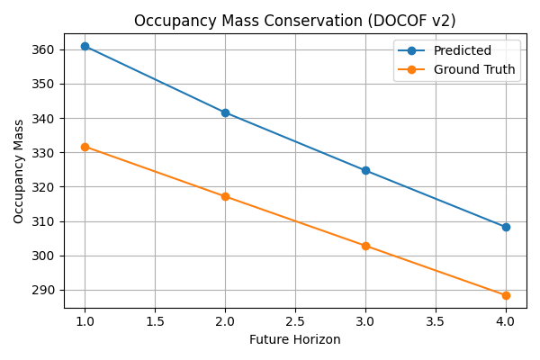
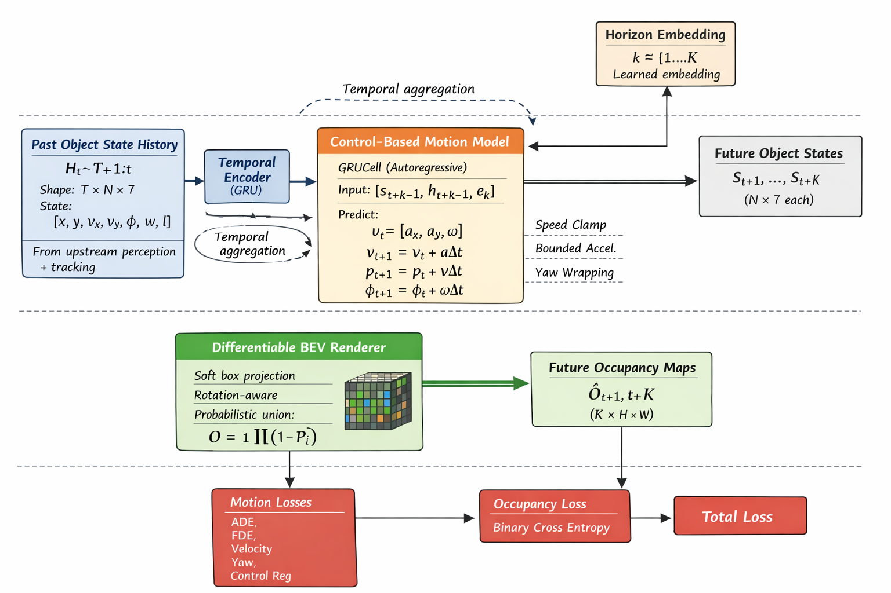
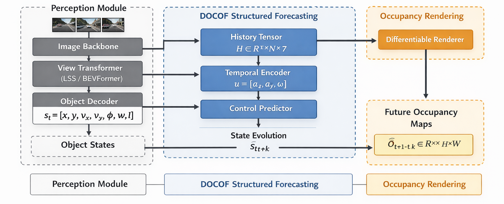
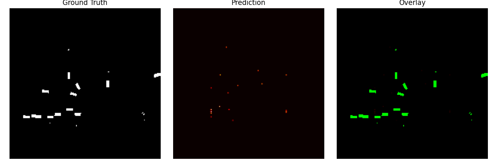
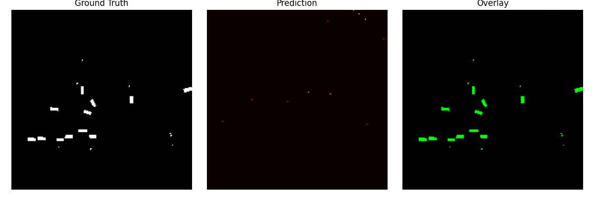

# DOCOF: Decomposed Object-Centric Occupancy Forecasting with Bounded Kinematic Integration for Stable Long-Horizon BEV Prediction

[](docs/DOCOF_paper.pdf)
[](docs/DOCOF_supplementary.pdf)
[](https://www.python.org/)
[](https://pytorch.org/)
[](https://www.nuscenes.org/)
[](LICENSE)
[](checkpoints/)

---

> **Official Implementation** of the paper:  
> **"Decomposed Object-Centric Occupancy Forecasting with Bounded Kinematic Integration for Stable Long-Horizon BEV Prediction"**  
> *Pritam Chakraborty, Anjan Bandyopadhyay, Siddhartha Bhattacharyya, Jan Platos, and Vaclav Snasel*  
> Published in IEEE / Preprint Available | [PDF](docs/DOCOF_paper.pdf) | [Supplementary](docs/DOCOF_supplementary.pdf)

---

## 📌 Table of Contents
- [Overview & Motivation](#-overview--motivation)
- [Key Features & Highlights](#-key-features--highlights)
- [Architecture & Design](#-architecture--design)
  - [1. Structured Object State](#1-structured-object-state)
  - [2. Horizon-Conditioned Kinematic Integration](#2-horizon-conditioned-kinematic-integration)
  - [3. Differentiable Probabilistic Occupancy Rendering](#3-differentiable-probabilistic-occupancy-rendering)
  - [4. Theoretical Non-Divergence Guarantee (Proposition 1)](#4-theoretical-non-divergence-guarantee-proposition-1)
- [Quantitative Benchmarks](#-quantitative-benchmarks)
  - [State-of-the-Art Comparison on nuScenes](#1-state-of-the-art-comparison-on-nuscenes)
  - [Horizon-Wise Degradation & Kinematic Stability](#2-horizon-wise-degradation--kinematic-stability)
  - [Clamp Ablation & Error Growth Rate](#3-velocity-clamp-ablation--growth-dynamics)
  - [Statistical Significance Testing](#4-statistical-significance-testing)
  - [Occupancy Mass Conservation](#5-occupancy-mass-conservation)
- [Ablation & Sensitivity Analysis](#-ablation--sensitivity-analysis)
  - [Component-wise Cumulative Ablation](#1-component-wise-cumulative-ablation)
  - [Efficiency & Scalability $\mathcal{O}(N)$ Analysis](#2-efficiency--scalability-mathcalon-analysis)
  - [Resolution and Perception Robustness](#3-resolution-and-perception-robustness)
- [Qualitative Visualizations](#-qualitative-visualizations)
- [Failure Mode Analysis](#-failure-mode-analysis)
- [Repository Structure](#-repository-structure)
- [Getting Started](#-getting-started)
  - [1. Installation & Environment](#1-installation--environment)
  - [2. Dataset Preparation (nuScenes)](#2-dataset-preparation-nuscenes)
  - [3. Pretrained Weights](#3-pretrained-weights)
  - [4. Quickstart / Demo Inference](#4-quickstart--demo-inference)
  - [5. Model Training](#5-model-training)
  - [6. Evaluation & Diagnostics](#6-evaluation--diagnostics)
- [Citation](#-citation)
- [Acknowledgements](#-acknowledgements)
- [License](#-license)

---

## 🔍 Overview & Motivation

Predicting future bird’s-eye-view (BEV) occupancy is vital for safe autonomous driving, allowing vehicles to plan collision-free trajectories through dynamic multi-agent environments. 

However, prevailing approaches (e.g., FIERY, ST-P3, UniAD, FipTR) formulate forecasting as **dense autoregressive feature regression**:
$$\mathbf{F}_{t+1} = \mathcal{G}(\mathbf{F}_t)$$
While effective over short horizons, this dense formulation suffers from core architectural limitations:
1. **Entangled Motion & Spatial Decoding**: Object dynamics are conflated with 2D/3D feature upsampling and decoding.
2. **Exponential Error Propagation**: A learned transition $\mathcal{G}$ with Lipschitz constant $L_{\mathcal{G}} > 1$ permits exponential error compounding $\|\mathbf{F}_{t+k} - \mathbf{F}^*_{t+k}\| \le L_{\mathcal{G}}^k \|\mathbf{F}_t - \mathbf{F}^*_t\|$, leading to spatial blur, phantom objects, and grid diffusion.
3. **Absence of Physical Constraints**: Latent space lacks kinematics bounds, allowing predictions to violate vehicle acceleration and speed limits.
4. **High Computational Burden**: Processing high-resolution BEV grids at every recursive step scales with grid area $\mathcal{O}(H \times W)$.

<p align="center">
  
</p>

### The DOCOF Paradigm
**DOCOF (Decomposed Object-Centric Occupancy Forecasting)** reformulates BEV forecasting as a physically constrained, object-centric dynamical evolution problem. Prediction is decomposed into:
- Structured state estimation ($[x, y, v_x, v_y, \phi, w, l]$),
- Horizon-conditioned, control-based kinematic rollout with hard velocity and acceleration clamps,
- Differentiable soft-box probabilistic rendering onto the BEV grid.

This separation guarantees **provably bounded, non-divergent drift** independently of the learned control policy, while reducing the forecasting module to just **0.15M parameters** and **0.03 GFLOPs** operating at **118 FPS**.

---

## 🌟 Key Features & Highlights

- **Decoupled Architecture**: Completely separates temporal motion modeling from spatial rasterization.
- **Physical Kinematics Integration**: Enforces explicit speed limits ($v_{max} = 40$ m/s / $144$ km/h), acceleration ceilings ($a_{max} = 10$ m/s²), and yaw rate constraints ($\omega_{max} = \pi$ rad/s).
- **Provable Stability (Proposition 1)**: Per-step displacement error is bounded by $2 v_{max} \Delta t \cdot k$, guaranteeing linear rather than exponential error growth.
- **Differentiable Soft-Box Renderer**: Renders object states directly to occupancy grids via an analytical sigmoid formulation, enabling full end-to-end backpropagation.
- **Ultra-Lightweight & Scalable**: Forecasting module requires only **0.15M parameters** and scales linearly with tracked objects $\mathcal{O}(N)$ rather than grid resolution $\mathcal{O}(H \times W)$.
- **State-of-the-Art on nuScenes**: Achieves **43.02% Mean Future IoU**, outperforming dense autoregressive baselines (UniAD 40.2%, FipTR-S 41.1%, ST-P3 38.9%, FIERY 36.7%).
- **Rigorous Horizon Diagnostics**: Evaluated across degradation gaps ($\Delta_k$), Smooth STD, and mass conservation.

---

## 🏗️ Architecture & Design

<p align="center">
  
</p>

The overall pipeline executes in three modular stages:

```
Multi-Camera Images (I_t)
         │
         ▼  [Perception: Shared Backbone + LSS + BEV Refinement + Object Decoder]
Structured States: s_t = [x, y, v_x, v_y, φ, w, l]
         │
         ▼  [Temporal Object Encoder: 1-Layer GRU, d=128]
Latent Motion Embedding: h_t
         │
         ▼  [Autoregressive Kinematic Rollout: GRUCell + Horizon Embedding e_k + Clamps]
Future States: s_{t+1:t+K}
         │
         ▼  [Differentiable Soft-Box Probabilistic Renderer R]
Predicted Occupancy Grids: Ô_{t+1:t+K} ∈ R^{K x 200 x 200}
```

### 1. Structured Object State
Each traffic participant $i$ is represented by a 7-dimensional physical state:
$$s^{(i)}_t = \left[x^{(i)}_t, \, y^{(i)}_t, \, v_{x,t}^{(i)}, \, v_{y,t}^{(i)}, \, \phi^{(i)}_t, \, w^{(i)}, \, l^{(i)}\right]$$
where $(x, y)$ is the planar position in the egocentric BEV frame, $(v_x, v_y)$ are velocity vectors, $\phi$ is the yaw angle, and $(w, l)$ denote object width and length. Trajectory history across $T=3$ frames is stacked into $H_{t-T+1:t} \in \mathbb{R}^{T \times N \times 7}$.

### 2. Horizon-Conditioned Kinematic Integration
A per-object GRU encodes the motion history into $h_t \in \mathbb{R}^{N \times d}$. Future states are evolved autoregressively:
$$h_{t+k} = \text{GRUCell}\left([s_{t+k-1}, \, e_k], \, h_{t+k-1}\right)$$
$$u_{t+k} = u_{max} \odot \tanh(W h_{t+k})$$
where $u_{t+k} = [a_x, a_y, \omega]$ are control updates, and $u_{max} = [a_{max}, a_{max}, \omega_{max}]$ hard-constrains controls via the bounded $\tanh$ function.

Kinematic state propagation follows discrete integration with hard velocity clipping:
$$v_{t+k} = \text{clamp}_{v_{max}}\left(v_{t+k-1} + a_{t+k} \Delta t\right), \quad \|v_{t+k}\| \le v_{max}$$
$$p_{t+k} = p_{t+k-1} + v_{t+k} \Delta t$$
$$\phi_{t+k} = \phi_{t+k-1} + \omega_{t+k} \Delta t$$

### 3. Differentiable Probabilistic Occupancy Rendering
For each object $i$, a smooth soft-box occupancy field is evaluated at grid coordinates $(x', y')$ aligned with the object frame:
$$P_i(x, y) = \sigma\left(\kappa \left(\frac{w}{2} - |x'|\right)\right) \cdot \sigma\left(\kappa \left(\frac{l}{2} - |y'|\right)\right)$$
where $\kappa = 10$ governs edge sharpness. Full scene occupancy is aggregated via probabilistic union in numerically stable log-space:
$$\hat{O}(x, y) = 1 - \prod_{i=1}^N (1 - P_i(x, y)) = 1 - \exp\left(\sum_{i=1}^N \log(1 - P_i(x, y))\right)$$

### 4. Theoretical Non-Divergence Guarantee (Proposition 1)
> **Proposition 1 (Bounded Drift)**: Under velocity bound $\|v_{t+k}\| \le v_{max}$ and consistent ground-truth kinematics, the position error at horizon $k$ satisfies:
> $$\|\delta p_{t+k}\| \le \|\delta p_t\| + 2 v_{max} \Delta t \cdot k$$
> Furthermore, since the renderer is Lipschitz with $L_R = \mathcal{O}(N\kappa)$, occupancy error satisfies:
> $$\|\hat{O}_{t+k} - O^*_{t+k}\| \le L_R \|\delta s_{t+k}\| \le L_R (C_1 k + C_2)$$

With $v_{max} = 40$ m/s and $\Delta t = 0.5$ s, the theoretical ceiling is $40$ m per step. In practice, DOCOF achieves an observed error growth of **1.245 m per step** ($32\times$ below the ceiling), proving non-divergent drift.

---

## 📊 Quantitative Benchmarks

### 1. State-of-the-Art Comparison on nuScenes
Evaluated on the official nuScenes validation set ($K=4$ horizons, $2.0$ s total, $\Delta t = 0.5$ s, vehicle class, $\pm 50$ m BEV range):

| Method | Backbone | BEV Encoder | Future IoU (%) ↑ | Total Parameters (M) ↓ | Forecasting GFLOPs ↓ | Forecasting FPS ↑ |
| :--- | :---: | :---: | :---: | :---: | :---: | :---: |
| **FIERY** (ICCV 2021) | EfficientNet | BEVDet4D | 36.70 | $\approx 38.0$ | — | — |
| **ST-P3** (ECCV 2022) | EfficientNet-B4 | — | 38.87 | $\approx 48.0$ | — | — |
| **FipTR-T** (ECCV 2024) | Swin-T | BEVDet4D | 38.30 | $\approx 56.0$ | — | — |
| **UniAD** (CVPR 2023) | ResNet-101 | BEVFormer | 40.20 | $\approx 95.0$ | — | — |
| **FipTR-R101** (ECCV 2024)| ResNet-101 | BEVFormer | 40.70 | — | — | — |
| **FipTR-S** (ECCV 2024) | Swin-S | BEVDet4D | 41.10 | — | — | — |
| **DOCOF (Ours)** | **ResNet-50** | **LSS** | **43.02** | **25.6 + 0.15** | **0.03** | **118** |

*Note: The forecasting module in DOCOF accounts for only 0.15M parameters. The full pipeline total is $\approx 28.1$ M.*

---

### 2. Horizon-Wise Degradation & Kinematic Stability
Performance across prediction horizons on nuScenes ($200 \times 200$ grid, $0.5$ m/cell):

| Horizon | Prediction Time | Occupancy IoU (%) ↑ | Mean Disp. Error (m) ↓ | Degradation Gap $\Delta_k$ (pp) ↓ | Retention Ratio |
| :---: | :---: | :---: | :---: | :---: | :---: |
| **$t+1$** | 0.5 s | **63.07** | **3.18** | 15.83 | — |
| **$t+2$** | 1.0 s | **47.24** | **4.53** | 12.06 | 0.749 |
| **$t+3$** | 1.5 s | **35.18** | **5.76** | 8.57 | 0.745 |
| **$t+4$** | 2.0 s | **26.61** | **6.92** | — | 0.756 |
| **Mean / Overall**| **2.0 s** | **43.02 (mIoU)**| **5.10 (ADE)** | **12.15 ± 3.63** | **0.750** |
| **Smooth STD** | — | — | **1.6082** | — | — |

<p align="center">
  
  
</p>

> **Key Observation**: IoU demonstrates remarkably stable degradation, retaining $\approx 75\%$ of its value per step. Displacement error grows strictly linearly ($R^2 > 0.99$) at a slope of 1.245 m/step without explosive upturn.

---

### 3. Velocity Clamp Ablation & Growth Dynamics
Comparing the full DOCOF pipeline with a variant removing the velocity clamp ($v_{max}$ relaxed):

| Configuration | $t+1$ (m) | $t+2$ (m) | $t+3$ (m) | $t+4$ (m) | Slope (m/step) | Mean IoU (%) | Smooth STD ↓ |
| :--- | :---: | :---: | :---: | :---: | :---: | :---: | :---: |
| **DOCOF (Full Model)** | **3.18** | **4.53** | **5.76** | **6.92** | **1.245** | **43.02** | **1.61** |
| DOCOF without Clamp | 3.45 | 5.10 | 6.80 | 8.50 | 1.685 | 39.80 | 2.18 |
| **Impact of Clamp** | **-0.27 m** | **-0.57 m** | **-1.04 m** | **-1.58 m** | **-26.1% slope**| **+3.22 pp** | **-0.57** |

<p align="center">
  
</p>

*The velocity clamp activates on approximately 8.0% of steps during validation, truncating implausible raw predictions (up to 63.4 m/s / 228 km/h) and preventing compound horizon drift.*

---

### 4. Statistical Significance Testing
Paired two-sided Wilcoxon signed-rank tests ($n = 150$ validation scenes, $\alpha = 0.05$) comparing DOCOF against the unclamped variant:

| Metric | DOCOF Full | No-Clamp | Median $\Delta$ | $p$-value | Rank-Biserial $r$ | 95% Confidence Interval |
| :--- | :---: | :---: | :---: | :---: | :---: | :---: |
| **Occupancy IoU (%)** | **43.02** | 39.80 | **+3.22 pp** | **$< 0.001$** | **0.92** | [2.85, 3.59] |
| **ADE (m)** | **5.10** | 5.96 | **-0.86 m** | **$< 0.001$** | **0.89** | [0.77, 0.95] |
| **FDE (m)** | **6.92** | 8.50 | **-1.58 m** | **$< 0.001$** | **0.91** | [1.44, 1.72] |

Friedman test across horizons $t+1 \dots t+4$ is significant ($p < 0.001$) for both IoU and displacement, confirming that degradation patterns are systematic across scenes rather than random artifacts.

---

### 5. Occupancy Mass Conservation
Occupancy mass $m_{t+k} = \sum_{x, y} \hat{O}_{t+k}(x, y)$ evaluates global spatial coherence:

| Horizon | Predicted Mass | Ground-Truth Mass | Relative Deviation $\text{Mass}@k$ (%) |
| :---: | :---: | :---: | :---: |
| **$t+1$** | 360.92 | 331.69 | 8.81% |
| **$t+2$** | 341.61 | 317.20 | 7.70% |
| **$t+3$** | 324.75 | 302.85 | 7.23% |
| **$t+4$** | 308.30 | 288.45 | **6.88%** |

<p align="center">
  
</p>

*Both predicted and ground-truth masses decrease smoothly as vehicles leave the $\pm 50$ m field of view. The deviation remains stable (6.88%–8.81%), showing neither mass collapse nor explosive inflation.*

---

## 🔬 Ablation & Sensitivity Analysis

### 1. Component-wise Cumulative Ablation
Progressively adding structured components to a baseline:

| Exp | GRU Encoder | Differentiable Renderer | Vel/Yaw Supervision | Validity Masking | Control Regularization | Velocity Clamp | Mean IoU (%) ↑ | Mean Disp. Err. (m) ↓ | Smooth STD ↓ |
| :---: | :---: | :---: | :---: | :---: | :---: | :---: | :---: | :---: | :---: |
| 1 | — | — | — | — | — | ✓ | 35.21 | 7.41 | 2.86 |
| 2 | ✓ | — | — | — | — | ✓ | 37.48 (+2.27) | 6.70 (-0.71) | 2.30 |
| 3 | ✓ | ✓ | — | — | — | ✓ | 40.19 (+2.71) | 6.03 (-0.67) | 1.95 |
| 4 | ✓ | ✓ | ✓ | — | — | ✓ | 41.76 (+1.57) | 5.61 (-0.42) | 1.78 |
| 5 | ✓ | ✓ | ✓ | ✓ | — | ✓ | 42.38 (+0.62) | 5.35 (-0.26) | 1.69 |
| **6 (Full)** | **✓** | **✓** | **✓** | **✓** | **✓** | **✓** | **43.02 (+0.64)**| **5.10 (-0.25)** | **1.61** |
| 7 | ✓ | ✓ | ✓ | ✓ | ✓ | ✗ | 39.80 (-3.22) | 5.96 (+0.86) | 2.18 |

---

### 2. Efficiency & Scalability $\mathcal{O}(N)$ Analysis
Runtime of the forecasting module across varying object counts on a single GPU:

| Number of Objects ($N$) | 20 Objects | 50 Objects | 100 Objects | 200 Objects |
| :--- | :---: | :---: | :---: | :---: |
| **Forecasting FPS** | **224.03 FPS** | **118.35 FPS** | **64.77 FPS** | **33.96 FPS** |
| **Inference Latency**| **4.46 ms** | **8.45 ms** | **15.44 ms** | **29.45 ms** |

*Because DOCOF operates on structured states, its runtime scales strictly with tracked agents $N$ rather than the $200 \times 200 = 40,000$ cells of the BEV grid.*

---

### 3. Resolution and Perception Robustness
- **BEV Grid Resolution**: Displacement error is identical (5.10 m) across $128\times 128$, $200\times 200$, and $256\times 256$, proving state propagation is decoupled from rasterization. The $200\times 200$ grid gives the best IoU (43.02%) matching the $\kappa = 10$ sharpness tuning.
- **Perception Backbone**: Replacing ResNet-50 with Swin-T changes IoU only marginally (43.02% $\to$ 43.60%, Disp. Err: 5.10 $\to$ 5.02 m).
- **Perception Quality**: Testing with Ground-Truth object detections yields 46.00% IoU and 4.98 m displacement, showing DOCOF is highly resilient to detection noise.

---

## 🖼️ Qualitative Visualizations

Predicted future BEV occupancy overlaid on ground truth across four horizons ($t+1 \dots t+4$):
- **Yellow (■)**: True Positive (Ground Truth & Prediction agree)
- **Green (■)**: False Positive (Predicted occupied, but free space in GT)
- **Red (■)**: False Negative (True occupied object missed)
- **Black**: True Negative (Free space)

<p align="center">
  
</p>

<p align="center">
  
</p>

*(Sample overlays from representative validation scenes in [`eval_results/`](eval_results/))*

---

## ⚠️ Failure Mode Analysis

<p align="center">
  
  
</p>

Through systematic failure case extraction ([`failure_cases/`](failure_cases/)), three main failure modes were identified:
1. **Dense Traffic Clusters**: Overlapping object bounding boxes can cause soft renderer overlap ambiguities, leading to fragmented local occupancy.
2. **Abrupt Lateral Maneuvers**: Sudden sharp turns violate the smooth-control prior, causing bounded underestimation of lateral displacement.
3. **Partial Occlusions**: Objects with missing history frames cause the temporal GRU to underestimate object presence.
*Crucially, in all cases predictions remain physically bounded and never diverge.*

---

## 📁 Repository Structure

```
DOCOF/
├── assets/                          # Visualization figures, diagnostic curves, architecture diagrams
├── checkpoints/                     # Pretrained PyTorch model checkpoints (.pth)
│   ├── docof_v2_best_mean.pth       # Best overall Mean IoU checkpoint (43.02%)
│   ├── docof_v2_best_smooth.pth     # Best Smoothness STD checkpoint (1.61)
│   ├── docof_v2_best_t1.pth         # Best t+1 horizon checkpoint
│   ├── docof_v2_best_t2.pth         # Best t+2 horizon checkpoint
│   ├── docof_v2_best_t3.pth         # Best t+3 horizon checkpoint
│   └── docof_v2_best_t4.pth         # Best t+4 horizon checkpoint
├── data/                            # Dataset loaders and BEV preprocessing
│   ├── nuscenes_docof_dataset_v2.py # Raw nuScenes dataset parser and track extraction
│   ├── docof_torch_dataset_v2.py    # Fast preprocessed tensor dataset
│   ├── export_docof_v2.py           # Preprocessing export script
│   ├── loader.py                    # Multi-camera LSS data loader
│   ├── nuscenes_loader.py           # NuScenes sensor calibration loader
│   └── object_occupancy_generator.py# Hard-rasterized ground-truth generator
├── models/                          # Neural network architectures
│   ├── docof_model_v2.py            # Complete DOCOF v2 model pipeline
│   ├── temporal_encoder_v2.py       # Object-centric trajectory GRU encoder
│   ├── motion_model_v2.py           # Bounded kinematic integrator & control head
│   ├── renderer_v2.py               # Analytical differentiable soft-box renderer
│   ├── bev_encoder.py               # Image-to-BEV LSS lifting module
│   ├── docof_model.py               # Baseline dense model
│   └── baseline_forecast_v2.py      # Autoregressive baseline comparison model
├── losses/                          # Training loss functions
│   └── losses_v2.py                 # Multi-task loss (BCE occ, ADE, FDE, Vel, Yaw, Reg)
├── training/                        # Training and evaluation routines
│   ├── trainer_v2.py                # Gradient-clipped training loop and validation logger
│   └── metrics.py                   # IoU, ADE, FDE, Smooth STD, and Mass metrics
├── experiments/                     # Reproducibility and diagnostic scripts
│   ├── evaluate_error_accumulation_docof_v2.py # Displacement error growth analysis
│   ├── evaluate_horizon_degradation_docof_v2.py# IoU decay analysis across horizons
│   ├── evaluate_mass_docof_v2.py               # Occupancy mass conservation
│   ├── evaluate_trajectory_docof_v2.py         # Track coordinate validation
│   ├── docof_v2_efficiency.py                  # FPS and FLOPs benchmarking
│   └── docof_failure_analysis.py               # Automated failure case extractor
├── eval_results/                    # Prediction samples across validation scenes
├── horizon_degradation_results/     # IoU degradation diagnostic curves
├── error_accumulation_results/      # Displacement growth diagnostic curves
├── mass_conservation_results/       # Mass conservation diagnostic curves
├── failure_cases/                   # Qualitative failure case examples
├── docs/                            # Official research publication & supplementary PDFs
│   ├── DOCOF_paper.pdf
│   └── DOCOF_supplementary.pdf
├── config.py                        # Unified system configuration
├── config_v2.py                     # Backward-compatible v2 configuration
├── main.py                          # Unified CLI entrypoint (train, eval, demo)
├── requirements.txt                 # Python dependencies
├── LICENSE                          # MIT License
└── README.md                        # Documentation
```

---

## 🚀 Getting Started

### 1. Installation & Environment

```bash
# Clone the repository
git clone https://github.com/Pritamresearch/DOCOF.git
cd DOCOF

# Create and activate a virtual environment
python -m venv venv
# On Windows:
venv\Scripts\activate
# On Linux/macOS:
source venv/bin/activate

# Install dependencies
pip install --upgrade pip
pip install -r requirements.txt
```

---

### 2. Dataset Preparation (nuScenes)

1. Download the **nuScenes** dataset (Full dataset or `v1.0-mini`) from [nuscenes.org](https://www.nuscenes.org/download).
2. Organize your directory structure:
```text
data/
└── nuScenes/
    ├── samples/
    ├── sweeps/
    ├── maps/
    └── v1.0-trainval/ (or v1.0-mini/)
```
3. Export preprocessed object tracks for high-throughput training:
```bash
python data/export_docof_v2.py --dataroot data/nuScenes --output preprocessed_docof_v2
```

---

### 3. Pretrained Weights

Pretrained model checkpoints are included directly in the [`checkpoints/`](checkpoints/) folder:
- `checkpoints/docof_v2_best_mean.pth`: Checkpoint achieving **43.02% Mean Future IoU**.
- `checkpoints/docof_v2_best_smooth.pth`: Checkpoint with lowest Smooth STD (**1.608**).
- `checkpoints/docof_v2_best_t1.pth` through `best_t4.pth`: Horizon-specific optimal checkpoints.

---

### 4. Quickstart / Demo Inference

Test the model immediately without needing the full nuScenes dataset using the built-in synthetic verification demo:

```bash
python main.py --mode demo --checkpoint checkpoints/docof_v2_best_mean.pth
```

#### Minimal Python Example

```python
import torch
from config import CONFIG
from models.docof_model_v2 import DOCOFv2

# 1. Initialize DOCOF
device = torch.device("cuda" if torch.cuda.is_available() else "cpu")
model = DOCOFv2(CONFIG).to(device)

# 2. Load pretrained weights
model.load_state_dict(torch.load("checkpoints/docof_v2_best_mean.pth", map_location=device))
model.eval()

# 3. Dummy input: (B=1, T=3 past frames, N=10 objects, D=7 states)
history = torch.randn(1, 3, 10, 7, device=device)
state_t = history[:, -1]
validity_masks = [torch.ones(1, 10, device=device) for _ in range(CONFIG["future_frames"])]

# 4. Forward rollout & differentiable rendering
with torch.no_grad():
    future_states, occupancies, controls = model(history, state_t, validity_masks)

print(f"Predicted {len(occupancies)} future BEV occupancy grids of shape {occupancies[0].shape}")
# Outputs 4 occupancy maps of shape [1, 200, 200]
```

---

### 5. Model Training

Train DOCOF from scratch on nuScenes:

```bash
python main.py --mode train --lr 1e-4 --epochs 30
```

Or run the modular trainer:

```bash
python training/trainer_v2.py
```

Training logs and metrics are automatically tracked in `training_log_v2.csv`.

---

### 6. Evaluation & Diagnostics

Run full diagnostic analysis across validation scenes:

```bash
# Evaluate displacement error growth
python experiments/evaluate_error_accumulation_docof_v2.py

# Evaluate horizon IoU degradation
python experiments/evaluate_horizon_degradation_docof_v2.py

# Evaluate occupancy mass conservation
python experiments/evaluate_mass_docof_v2.py

# Benchmark inference speed and parameter scalability
python experiments/docof_v2_efficiency.py
```

---

## 📜 Citation

If you find DOCOF useful in your research or application, please cite our paper:

```bibtex
@article{chakraborty2026docof,
  title     = {Decomposed Object-Centric Occupancy Forecasting with Bounded Kinematic Integration for Stable Long-Horizon BEV Prediction},
  author    = {Chakraborty, Pritam and Bandyopadhyay, Anjan and Bhattacharyya, Siddhartha and Platos, Jan and Snasel, Vaclav},
  journal   = {},
  year      = {2026},
  note      = {Under review / Preprint}
}
```

---

## 🤝 Acknowledgements

- This research was supported by the **Visvesvaraya Ph.D. Scholarship Scheme**, awarded by the **Ministry of Electronics and Information Technology (MeitY)**, Government of India.
- The authors thank the **nuScenes** development team at Motional for creating and maintaining the multimodal autonomous driving benchmark.

---

## 📄 License

This repository is licensed under the **MIT License** — see the [LICENSE](LICENSE) file for details.
